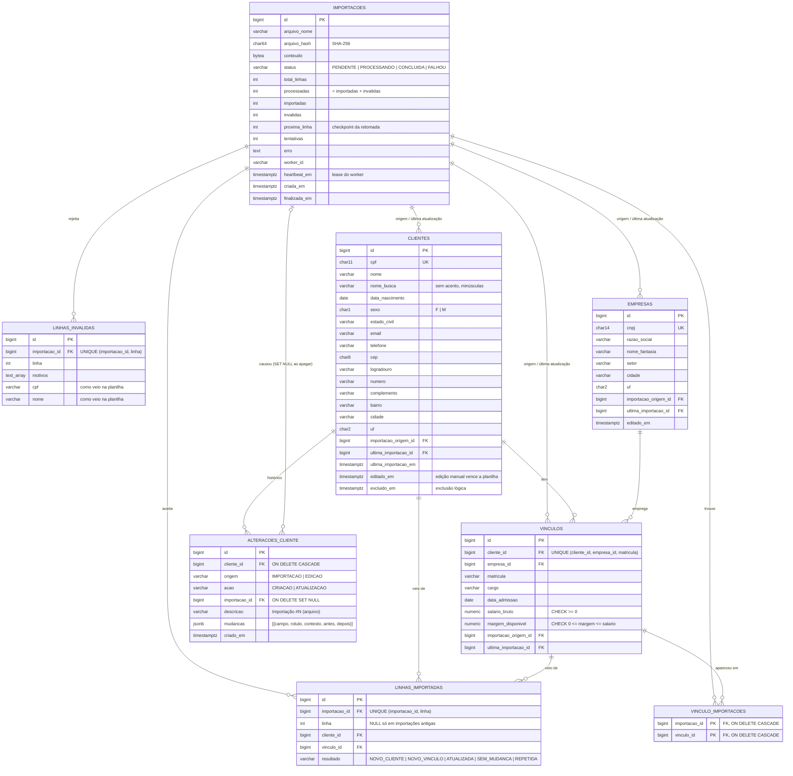

# Modelo de dados

## Por que este formato

- **`vinculo_importacoes` guarda todas as importações em que cada vínculo apareceu**, não só a primeira e a última. É o que permite apagar uma importação sem levar junto clientes que também vieram de outras planilhas (DECISOES.md, item 10).
- **`linhas_importadas` e `linhas_invalidas` se espelham**: toda linha processada está em uma das duas, então a aba "Aceitas" bate com o contador de importadas (DECISOES.md, item 11).
- **`alteracoes_cliente` guarda o valor antigo e o novo de cada campo que mudou**, por importação ou edição manual. Se a importação for apagada, o histórico fica (DECISOES.md, item 8).
- **Empresa é entidade**, não coluna repetida: aparece em dezenas de linhas e é editada num lugar só.
- **Matrícula, cargo, admissão, salário e margem são do vínculo**, não do cliente: a mesma pessoa pode ter dois empregos ao mesmo tempo, cada um com sua margem.
- **Cidade e UF ficam como texto normalizado** (UF validada contra a lista oficial). Uma tabela de municípios exigiria o código IBGE, que a planilha não traz.

## Constraints no banco

| Regra | Onde |
|---|---|
| CPF e CNPJ só com dígitos e no tamanho certo | `CHECK (cpf ~ '^[0-9]{11}$')`, `CHECK (cnpj ~ '^[0-9]{14}$')` |
| CPF, CNPJ e vínculo únicos | `uq_clientes_cpf`, `uq_empresas_cnpj`, `uq_vinculos_cliente_empresa_matricula` |
| Margem entre zero e o salário | `CHECK (margem_disponivel >= 0)`, `CHECK (margem_disponivel <= salario_bruto)` |
| Contadores coerentes | `CHECK (processadas = importadas + invalidas)`, `CHECK (processadas <= total_linhas)` |
| Status conhecido | `CHECK (status IN (...))` |
| Linha rejeitada ou aceita não duplica na retomada | `uq_linha_invalida`, `uq_linha_importada (importacao_id, linha)` |
| Resultado da linha conhecido | `CHECK (resultado IN (...))` |
| Cada aparição de um vínculo numa importação, uma vez só | PK `vinculo_importacoes (importacao_id, vinculo_id)` |
| Histórico sempre com lista de mudanças; só "criação" pode vir vazia | `CHECK (jsonb_typeof(mudancas) = 'array')`, `CHECK (acao = 'CRIACAO' OR jsonb_array_length(mudancas) > 0)` |
| Integridade referencial | Todas as FKs acima |

Os índices e o motivo de cada um estão em [DECISOES.md, item 7](../DECISOES.md#7-busca-e-índices).
